# TTMS - Trauma Team Management System

This is a desktop app I made for a university course. It manages the clients and missions of a Trauma Team, the private medical rescue company from Cyberpunk 2077. The sample data uses characters and places from the game.

I built it with Java, Spring Boot, JPA, an H2 database and Swing. The look comes from FlatLaf.

In the window you can add and delete clients and missions, search clients by email and assign clients to missions. You can also add objectives and launch missions, build teams, manage vehicles, pilots and medics, change a person's role, and assign policies and implants.

The database is in memory. It is filled with the sample data every time the app starts, so your changes are gone after you close it.

## Design

This is the design diagram I made for the project. Click it to see it full size.

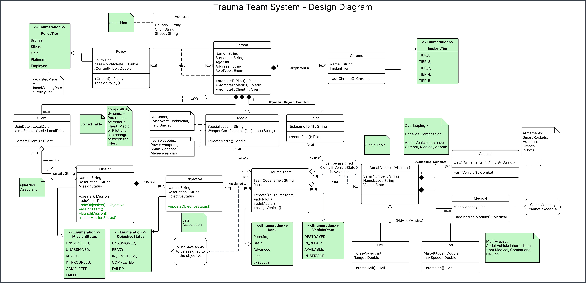

A mission changes status as its objectives get teams and finish. This diagram shows how.

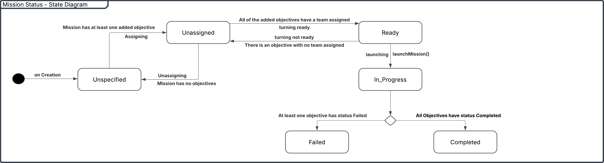

## How to run

You need Java 17 or newer.

```
./mvnw spring-boot:run
```

You can also build a jar and run that:

```
./mvnw package
java -jar target/traumateam-0.0.1-SNAPSHOT.jar
```

To run the tests:

```
./mvnw test
```

## Screenshots

The client list with the details of the selected client. There is a dark theme and a light theme.

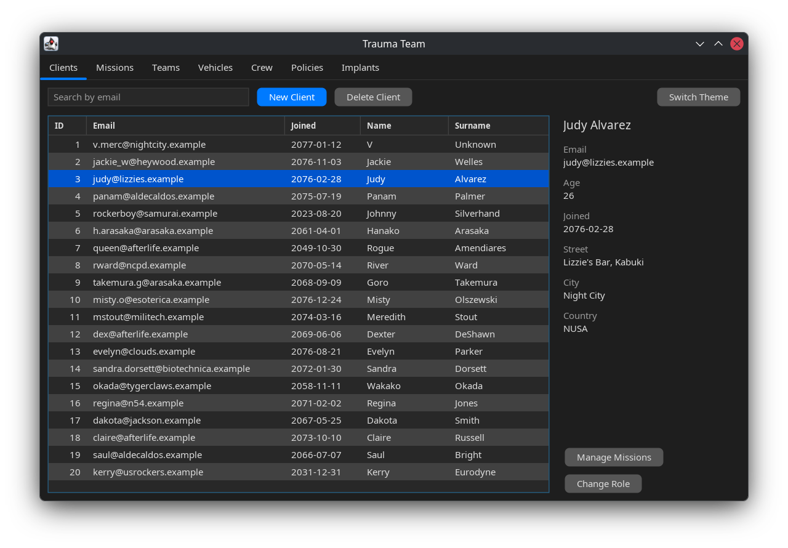

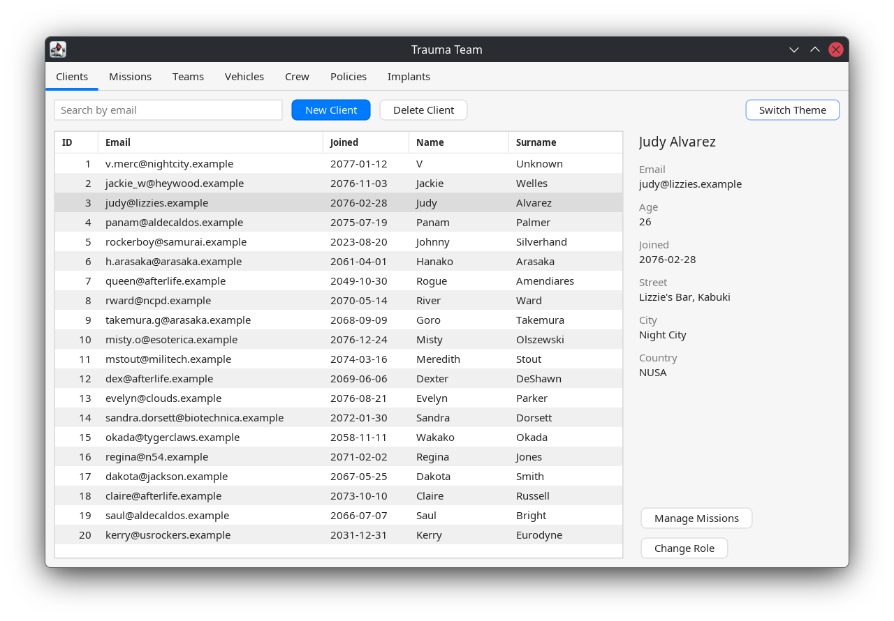

The missions and their status.

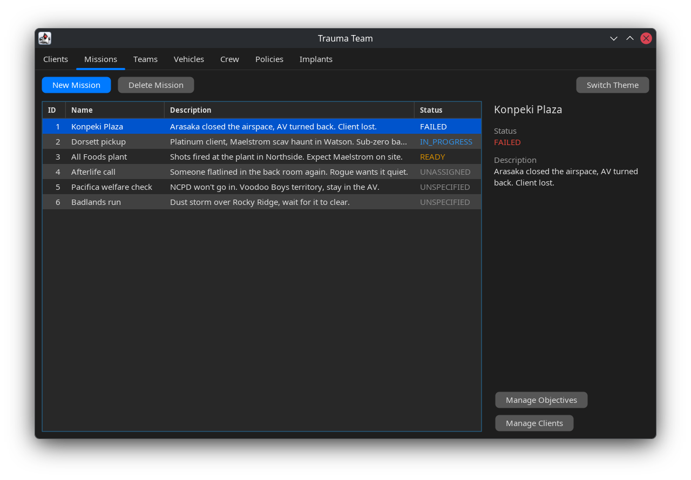

Assigning clients to a mission.

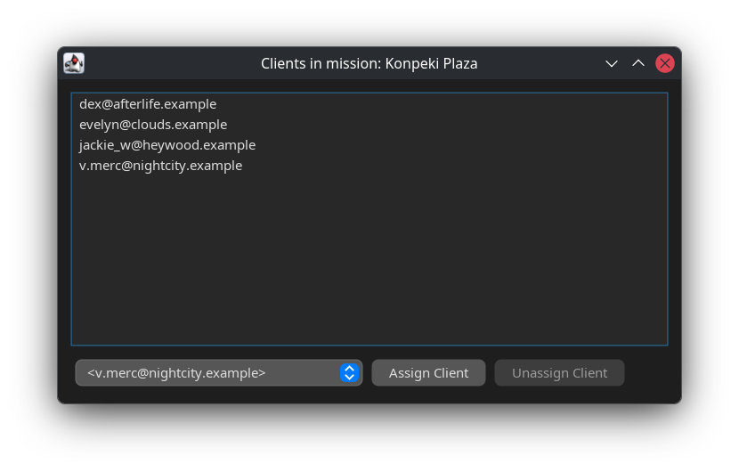

A team with its vehicles, pilots and medics.

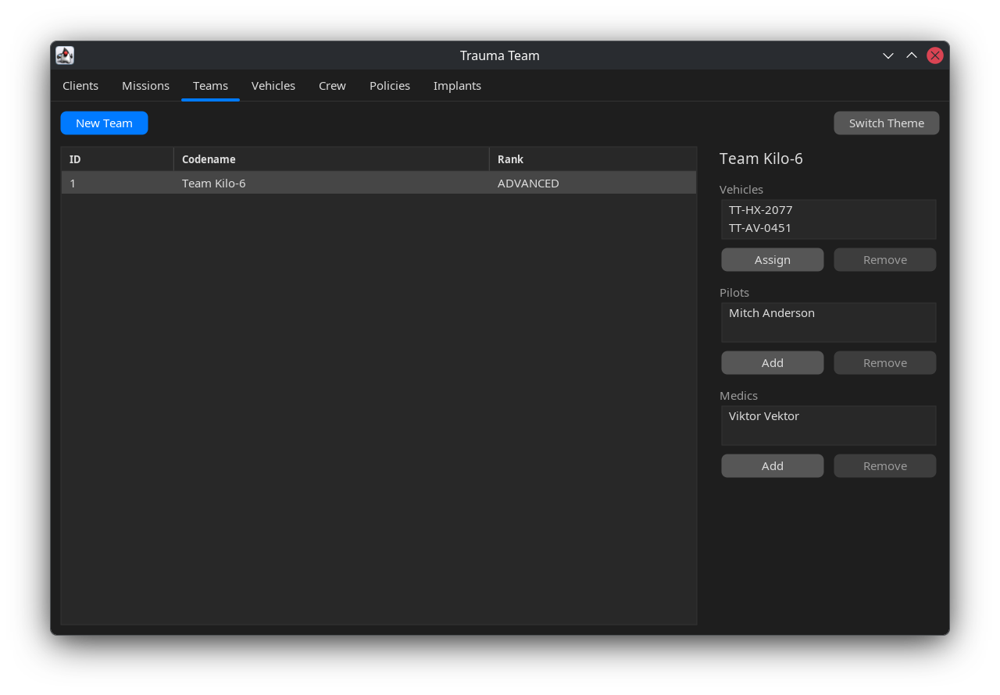

The vehicles, where you can change weapons and medical modules.

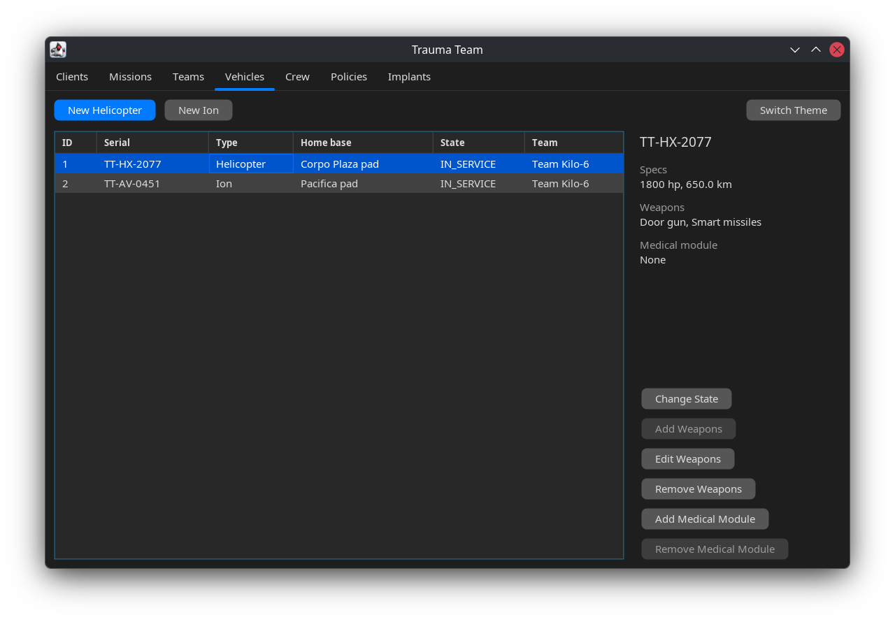

The pilots and medics.

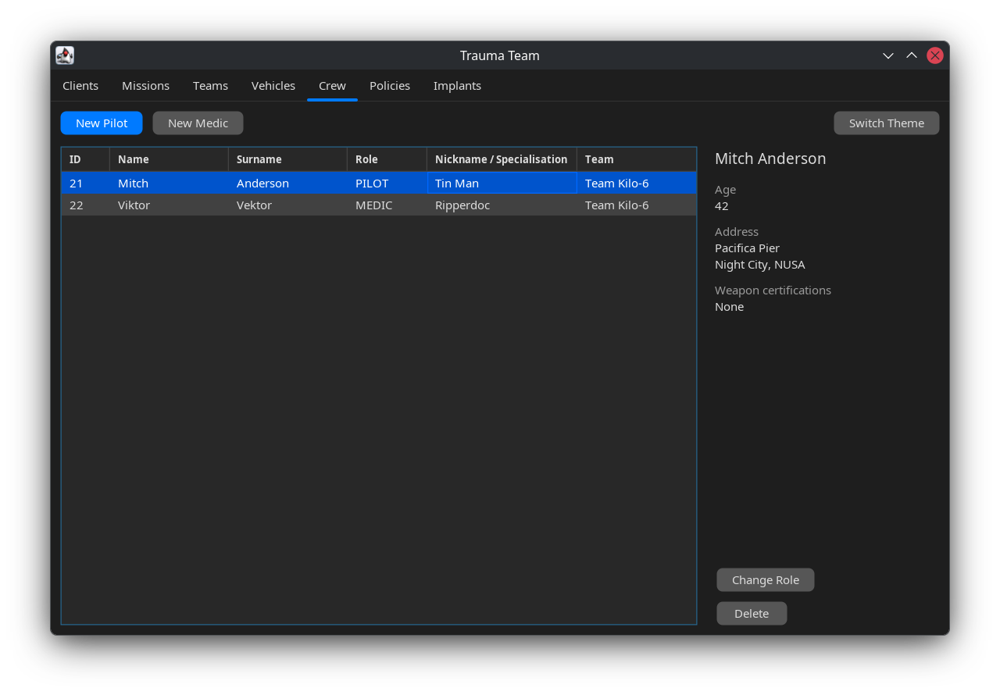

The policies and who is on them.

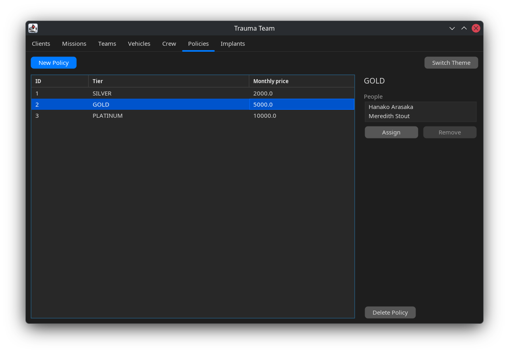

The implants and their owners.

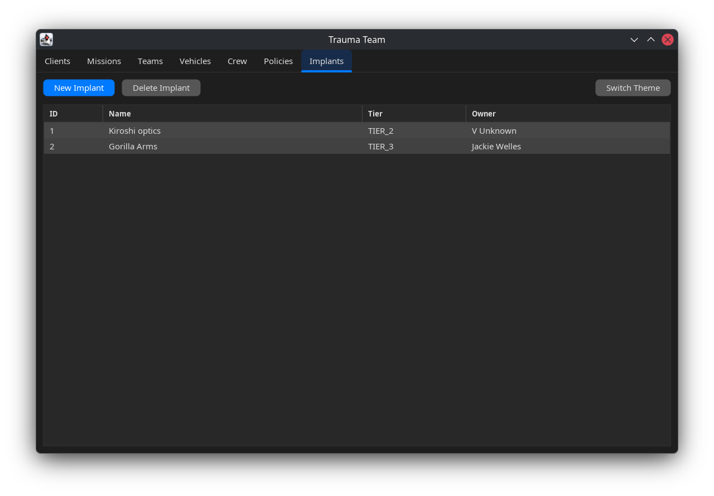
